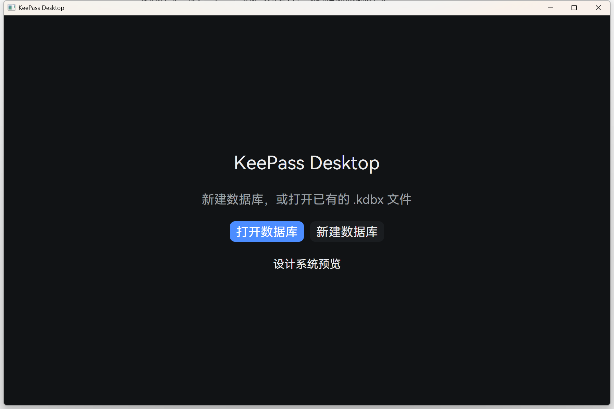

# KeePassDesktop

A KeePass-compatible desktop client. Rust + GPUI. v1 targets Windows.



## Status

Pre-alpha. The workspace builds, the window opens, and the vault layer has its
boundary and tests. No vault file can be opened yet.

See [docs/architecture.md](docs/architecture.md) for the design, the decisions
behind it, and the open gates.

## Requirements

- Rust 1.99+ (`stable-x86_64-pc-windows-msvc`)
- Visual Studio Build Tools with the C++ workload (MSVC linker + Windows SDK)

## Build

```powershell
cargo build --workspace
cargo test  --workspace
cargo run   -p app
```

## Layout

| Crate | Role |
|---|---|
| `keepass-core` | KDBX read/write, key material, disk transactions. Leaf crate. |
| `vault-model` | Domain types and use cases. No UI, no storage details. |
| `design-system` | Design tokens and atomic controls. Only consumer of `gpui-kit`. |
| `platform-api` | Platform traits: clipboard, session lock, single instance, paths. |
| `platform-win` | Windows implementations. |
| `app` | Assembly: state machine, routing, screens. |

The dependency direction is one-way and load-bearing:
`app -> {vault-model, design-system} -> keepass-core`, and `design-system` is the
only place `gpui-kit` appears. That keeps the GPUI base backend swappable and
keeps plaintext away from UI code.

## Interop with the HarmonyOS client

Vault files are shared with [KeePassHomo](https://github.com/) (the HarmonyOS
client this project references). The private markers each side writes are
documented in `crates/keepass-core/src/interop.rs`; changing one of those strings
breaks the other app.

## Security notes

This is a password manager. The invariants that must hold are listed in
[docs/architecture.md §9](docs/architecture.md) and each has a test or a gate.

Reporting a vulnerability: open a private security advisory rather than a public
issue.

## License

MIT. See [LICENSE](LICENSE).
